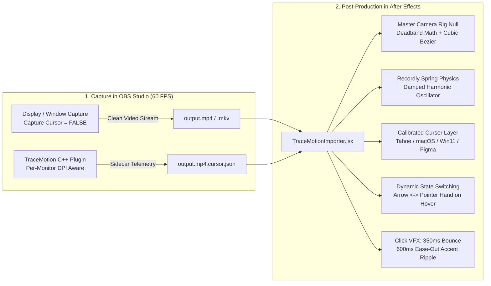

# 🎥 TraceMotion

> **High-Performance Decoupled Mouse Telemetry Capture & Post-Production Suite**  
> *Bridging 60 FPS Native Screen Capture in OBS Studio directly to Adobe After Effects & Recordly.*

[](https://github.com)
[](https://obsproject.com)
[](https://adobe.com)
[](https://isocpp.org)
[](LICENSE)

---

## 🌟 Overview

**TraceMotion** is an open-source, decoupled capture and motion graphics pipeline. It allows creators, software engineers, and motion designers to record pristine, 60 FPS uncompressed screen footage in **OBS Studio** while capturing high-frequency cursor coordinates, clicks, and visual states into a synchronized sidecar file (`.cursor.json`). 

In post-production, the companion **Adobe After Effects Importer** (`TraceMotionImporter.jsx`) parses this telemetry, automatically constructing an intelligent 2D/3D camera rig with deadband safe zones, cinematic easing, animated vector cursors, and click ripple VFX.



---

## ⚡ Why Decoupled Capture?

Traditional screen recorders bake camera zooms and cursor effects directly into the video stream during recording. This creates critical production bottlenecks:

| Traditional Baked Recording | TraceMotion Decoupled Architecture |
| :--- | :--- |
| ❌ **Destructive**: Once encoded, cropped canvas is lost forever. | ✅ **100% Non-Destructive**: Raw video is untouched; camera zooms are fully editable keyframes. |
| ❌ **Lagging Camera**: Real-time engines react *after* mouse motion. | ✅ **Lookahead Operators**: Anticipates motion with smooth ease-in lead transitions. |
| ❌ **Encoder Drops**: Physics solvers compete with NVENC/GPU. | ✅ **Zero Overhead**: Captures telemetry in $<0.05\%$ CPU with zero dropped frames. |
| ❌ **Blurry Bitmaps**: Baked cursors pixelate when scaled up. | ✅ **Infinite Vector Clarity**: Renders crisp shape-layer cursors with dynamic velocity sway. |

---

## 🚀 Quick Start Guide (For Users)

### Step 1: Install the OBS Plugin

1. Download or clone this repository:
   ```bash
   git clone https://github.com/your-username/TraceMotion.git
   ```
2. Navigate to `TraceMotion/obs-telemetry-recorder/`.
3. If you downloaded a release with prebuilt binaries, simply **right-click `install.bat` and select "Run as administrator"**.
   - If compiling from source, run `build.bat` first (see [Building from Source](#-building-from-source)), then run `install.bat`.
4. Launch **OBS Studio**.
5. Check `Help -> Log Files -> View Current Log` and confirm you see:
   ```text
   [TraceMotion] Loading TraceMotion OBS Studio Telemetry Plugin v1.0.0...
   ```

---

### Step 2: Configure OBS for Clean Recording

To get the full cinematic benefit of TraceMotion:
1. In your OBS Scene, double-click your **Display Capture** or **Window Capture** source.
2. **UNCHECK "Capture Cursor"**.
   > *Why? This records a 100% clean video with no visible Windows cursor. TraceMotion will reconstruct a sharp, scalable vector cursor in After Effects.*
3. Set your preferred recording format to **MP4** or **MKV** (`Settings -> Output -> Recording`).
4. Click **Start Recording**, interact with your apps, and click **Stop Recording**.
5. Open your recorded video folder (`C:\Users\<YourUser>\Videos\`). You will see:
   ```text
   2026-10-31 23-45-00.mp4
   2026-10-31 23-45-00.mp4.cursor.json
   ```

---

### Step 3: Import & Generate Rigs in Adobe After Effects

1. Open **Adobe After Effects** (CC 2020 through 2026+).
2. Install the dockable ScriptUI panel:
   - Copy `after-effects-importer/TraceMotionImporter.jsx` and `after-effects-importer/assets/` into:
     `Support Files/Scripts/ScriptUI Panels/`
   - Open from the top menu: **Window -> TraceMotionImporter.jsx**.
3. In the dark-studio panel (Setup | Cursor | Frame):
   - **Setup Tab**:
     - Browse and select your recorded video file (`.mp4` or `.mkv`). The companion `.cursor.json` is auto-detected.
     - Choose Camera Zoom Mode (**Auto Zoom**, **Follow**, or **Static**) and zoom depth (e.g. 1.80x).
     - Select Motion Feel (**Natural**, **Snappy**, **Silky**, or **Raw**).
     - Fine-tune toggles: Auto Cursor States, Velocity Tilt Sway, Click Bounce, Composition Motion Blur, and Typing Speed-Up.
   - **Cursor Tab**:
     - Choose from 4 curated cursor packs (**macOS Tahoe**, **macOS Classic**, **Windows 11 Fluent**, **Figma Minimal**).
     - Set cursor size (50% to 200%) and Click Ripple color (**Cobalt #2563EB**, **White**, **Emerald**, **Amber**).
     - Click inside the interactive preview stage at the top to test ripple animations live.
   - **Frame Tab**:
     - Choose from 6 visual backdrop tiles or the full 39 Recordly wallpaper dropdown.
     - Adjust Corner Radius, Window Margin, and Multi-Stage Soft Drop Shadows.
   - Click **Generate Motion Comp**.
4. In seconds, After Effects builds the complete studio motion rig:
   - **`TraceMotion_Camera_Rig`**: Recordly 1:1 straight-line camera rig with zero waggle or reverse drift.
   - **`TraceMotion_Camera_Controller`**: Live tuning sliders for Zoom Scale, Margin, Corner Radius, Shadow, Sway, and Focus Point.
   - **`TraceMotion_Cursor_Master`**: Damped harmonic oscillator spring null with dynamic velocity tilt sway and click depression bounce.
   - **`Cursor_*` Multi-State Layers**: 10 authentic system cursor shapes switching instantly via Opacity hold keyframes.
   - **`TraceMotion_Click_Ripples`**: Two-tier ripple VFX with inner soft pop disc (120ms) and expanding outer shockwave ring (450ms, cubic ease-out).
   - **`TraceMotion_Window_Matte` & `TraceMotion_Window_Shadow`**: Rounded-corner track matte and multi-stage ambient/body/contact soft drop shadows.
   - **`TraceMotion_Background`**: Wallpaper or gradient cover-scaled to composition bounds.

---

## 🛠️ Building from Source

### Prerequisites
- Windows 10 or 11 (64-bit)
- Visual Studio 2022 / 2026 (MSVC v143 or newer with C++ Desktop Development)
- CMake 3.22+ (optional if using automated batch build)
- OBS Studio 30.0+ / 33.0+

### Option A: 1-Click Automated Native Build (Recommended)
Double-click `TraceMotion/obs-telemetry-recorder/build.bat`. It will automatically:
- Locate your Visual Studio installation.
- Generate standard OBS SDK import libraries (`obs.lib`, `obs-frontend-api.lib`).
- Compile and link `build/tracemotion-obs.dll` with optimized C++20 release flags.

### Option B: CMake Build
```powershell
cd TraceMotion/obs-telemetry-recorder
mkdir build
cd build
cmake .. -A x64 -DOBS_DIR="C:/Program Files/obs-studio"
cmake --build . --config Release
```

Once built, right-click `install.bat` and run as Administrator to install.

---

## 📁 Repository Directory Structure

```text
TraceMotion/
├── README.md                          # Comprehensive documentation (this file)
│
├── obs-telemetry-recorder/            # OBS Studio C++20 Native Plugin
│   ├── CMakeLists.txt                 # CMake configuration for MSVC x64
│   ├── build.bat                      # 1-Click automated MSVC native compiler
│   ├── install.bat                    # 1-Click UAC-elevated installer (OBS 33+ & legacy)
│   ├── data/                          # Plugin assets & metadata
│   │   ├── manifest.json              # OBS 33 unified plugin descriptor
│   │   └── locale/en-US.ini           # English localization strings
│   ├── deps/obs/                      # Standalone OBS SDK interface stubs
│   │   ├── include/                   # ABI-accurate OBS headers
│   │   │   ├── obs-module.h
│   │   │   ├── obs-frontend-api.h
│   │   │   └── util/platform.h
│   │   └── lib/                       # Pre-generated 64-bit import libraries
│   │       ├── obs.lib
│   │       └── obs-frontend-api.lib
│   ├── include/
│   │   ├── telemetry_common.hpp       # Data structs, enums, & schema definitions
│   │   └── telemetry_worker.hpp       # Background worker thread declaration
│   └── src/
│       ├── main.cpp                   # OBS module lifecycle & frontend event callbacks
│       └── telemetry_worker.cpp       # Zero-allocation high-frequency mouse telemetry poller
│
└── after-effects-importer/            # Adobe After Effects Importer & Rig Generator
    ├── TraceMotionImporter.jsx        # ExtendScript / ScriptUI rig generator
    ├── port_cursors.cjs               # Asset rasterization & synchronization utility
    └── assets/cursors/                # Ported Recordly Cursor Assets (106 SVGs + 106 Retina PNGs)
        ├── manifest.json              # Hotspot calibration & dimension metadata
        ├── tahoe/                     # macOS Tahoe cursor set (Recordly default)
        ├── macos/                     # macOS Classic cursor set
        ├── windows11/                 # Windows 11 Fluent cursor set
        └── custom/                    # Figma / Minimal cursor set
```

---

## 📐 Telemetry Data Schema (Recordly Version 2)

TraceMotion writes compact, valid JSON matching Recordly's production schema with display geometry calibration:

```json
{
  "version": 2,
  "canvas": {
    "sourceWidth": 1920,
    "sourceHeight": 1080,
    "sourceX": 0,
    "sourceY": 0,
    "outputWidth": 1920,
    "outputHeight": 1080
  },
  "samples": [
    {
      "timeMs": 0,
      "cx": 0.5000,
      "cy": 0.5000,
      "interactionType": "move",
      "cursorType": "arrow"
    },
    {
      "timeMs": 1420,
      "cx": 0.7231,
      "cy": 0.3104,
      "interactionType": "click",
      "cursorType": "pointer"
    },
    {
      "timeMs": 1780,
      "cx": 0.7231,
      "cy": 0.3104,
      "interactionType": "mouseup",
      "cursorType": "pointer"
    }
  ]
}
```

### Schema Attributes:
- **`version`**: Integer schema version (`2`).
- **`canvas`**: Calibration metadata containing base source dimensions (`sourceWidth`, `sourceHeight`), crop origin offsets (`sourceX`, `sourceY`), and scaled output resolution (`outputWidth`, `outputHeight`).
- **`timeMs`**: Monotonic presentation timestamp in milliseconds relative to video start ($t=0$).
- **`cx`, `cy`**: Normalized floating-point cursor position $[0.0000, 1.0000]$ relative to canvas width and height.
- **`interactionType`**: `"move"`, `"click"`, `"double-click"`, `"right-click"`, `"middle-click"`, or `"mouseup"`.
- **`cursorType`**: `"arrow"`, `"text"`, `"pointer"`, `"crosshair"`, `"open-hand"`, `"closed-hand"`, `"resize-ew"`, `"resize-ns"`, or `"not-allowed"`.

---

## ❓ Troubleshooting & FAQ

#### Q1: OBS does not show `[TraceMotion]` in the log file.
- Verify that you ran `install.bat` **as Administrator**.
- OBS 33 looks inside `C:\ProgramData\obs-studio\plugins\tracemotion-obs\`. Make sure `tracemotion-obs.dll` and `data/manifest.json` are present in that directory.
- Open `Help -> Log Files -> View Current Log` inside OBS to check for initialization messages.

#### Q2: The `.cursor.json` file is missing after recording.
- Make sure you hit **Stop Recording** (do not force-close OBS while recording).
- Check your default video output directory (`Settings -> Output -> Recording Path`). The `.cursor.json` file is placed directly next to your video file.

#### Q3: Windows Defender or SmartScreen flags `install.bat`.
- Batch scripts requesting UAC elevation (`Start-Process -Verb RunAs`) trigger standard Windows prompts on unverified scripts. You can inspect the plain text of `install.bat` and `build.bat` in any text editor to verify they contain only file copying and compiler commands.

#### Q4: What video codecs work best?
- Any video format supported by OBS and After Effects works (NVENC H.264, AMD AMF, QuickSync, Apple ProRes, x264 in `.mp4` or `.mkv` containers).

---

## 📄 License

This project is licensed under the **MIT License** — feel free to use, modify, and distribute it for both commercial and personal projects. See `LICENSE` for details.
