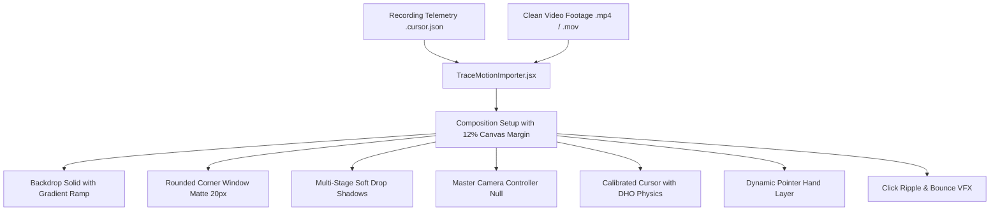

# 🎬 TraceMotion After Effects Importer & Rig Generator

> **Production ScriptUI Suite for Adobe After Effects (CC 2020 through CC 2026+).**  
> Complete reverse-engineered Recordly framing, smart-zoom, and cursor animation pipeline.

---

## 🌟 Overview

`TraceMotionImporter.jsx` is an elite ExtendScript tool that ingests screen recordings and synchronized mouse telemetry (`.cursor.json`) emitted by the TraceMotion OBS plugin or Recordly. It automatically constructs a production-grade floating window framing rig, smart camera zoom trajectory, and authentic calibrated cursor physics inside native After Effects compositions.

---

## ✨ Features

### 1. Recordly Smart Zoom & Pan Engine
Replicates Recordly's production zoom detection and framing algorithms:
- **Interaction Clustering:** Identifies explicit click events (`click`, `double-click`, `right-click`) and sustained mouse dwells ($450\text{ms} - 2600\text{ms}$) within a $0.02$ normalized distance threshold.
- **Cluster Merging:** Consecutive interactions within $2500\text{ms}$ are merged into single dynamic zoom sequences with $500\text{ms}$ pre-roll and post-roll margins.
- **Recordly Scale Levels:** 1.25x, 1.50x, 1.80x (Recordly Signature Default), 2.20x, and 3.50x.
- **Safety Bounds & Edge Snapping:** Clamps camera focus to $marginX = \frac{1}{2 \cdot \text{scale}}$ and $marginY = \frac{1}{2 \cdot \text{scale}}$, preventing the camera from ever revealing canvas edges outside the capture.
- **Cubic Bézier Transitions:** Keyframes camera focus and zoom scale using smooth cubic Bézier easing curves ($\text{KeyframeEase}(0, 84.0)$) matching Recordly's $\text{cubicBezier}(0.16, 1.0, 0.3, 1.0)$.

### 2. Automatic Desktop Window Framing
Raw screen captures are never displayed edge-to-edge; they float like a modern desktop application window:
- **Rounded Corner Track Matte:** Automatically creates an alpha matte shape layer with configurable corner radius ($16\text{px} - 24\text{px}$, default $20\text{px}$) dynamically linked to the master controller.
- **Multi-Stage Soft Drop Shadow:** Applies two realistic drop shadows to the capture layer:
  - *Ambient Diffusion:* Distance $20\text{px}$, Softness $56\text{px}$, Opacity $50\%$, Direction $180^\circ$.
  - *Contact Depth:* Distance $5\text{px}$, Softness $16\text{px}$, Opacity $30\%$, Direction $180^\circ$.
- **Backdrop Gradient Solids:** Generates a backdrop solid underneath the floating capture with 5 modern presets:
  - **Tahoe Dawn:** macOS Electric Blue to Warm Violet.
  - **Dark Studio:** Charcoal to Deep Black radial ramp.
  - **Midnight Deep:** Slate Navy to Indigo radial ramp.
  - **Sequoia Azure:** Vibrant Azure Cobalt gradient.
  - **Clean Charcoal Solid:** Solid `#1E1E20`.
  - **Transparent / None:** Edge-to-edge transparency for custom video compositing.
- **Canvas Breathing Room:** Automatically sizes the composition with $10\% - 15\%$ margin (default $12\%$) so rounded corners and drop shadows are visible.

### 3. Authentically Calibrated Cursor Assets
- Includes 106 vector SVGs and 106 pre-rendered 512px Retina transparent PNGs ported 1:1 from Recordly:
  - **macOS Tahoe** (`tahoe`): Modern macOS pointer (Recordly default).
  - **macOS Classic** (`macos`): Classic Apple cursor profile.
  - **Windows 11 Fluent** (`windows11`): Microsoft Fluent Design pointer.
  - **Figma / Custom** (`custom`): Minimal crosshair and modern UI pointer.
  - **Vector Shape**: Procedural fallback shape layer.
- **Zero Coordinate Drift:** Anchor points are mathematically locked to exact visual hotspots (`layerWidth * anchorX, layerHeight * anchorY`). Position expression uses `vid.toComp(value)` to maintain perfect alignment during camera zooms and pans.

### 4. Damped Harmonic Oscillator (DHO) Physics
- Numerical spring solver replicating Recordly cursor motion:
  $$\text{accel} = \frac{-k \cdot (\text{pos} - \text{target}) - c \cdot \text{vel}}{m}$$
- Custom tuning slider ($0.10$ to $1.50$, default $0.67$) supporting snappy focused movement or cinematic fluid trailing.
- **Dynamic Velocity Sway:** Cursor tilts dynamically into movement directions based on instantaneous velocity.

### 5. Clean Click Ripple VFX (Zero Center Circle Artifact)
- Emits expanding circular shockwaves during mouse click events.
- **Artifact Elimination:** Employs a strict 4-point temporal opacity envelope ($0\%$ at $t=0$, $0\%$ at $t_{\text{click}} - 16\text{ms}$, $65\%$ at $t_{\text{click}}$, $0\%$ at $t_{\text{click}} + 550\text{ms}$).
- Guaranteed $0\%$ opacity and $[0, 0]$ scale when inactive—no center circle or diagnostic overlays will ever appear in your render output.

---

## 🚀 How to Use

### Installation as a Dockable ScriptUI Panel
1. Copy `TraceMotionImporter.jsx` into your After Effects Scripts folder:
   - **Windows:** `C:\Program Files\Adobe\Adobe After Effects <version>\Support Files\Scripts\ScriptUI Panels\`
   - **macOS:** `/Applications/Adobe After Effects <version>/Scripts/ScriptUI Panels/`
2. Restart After Effects (or click **Window > TraceMotionImporter.jsx**).
3. Dock the panel anywhere in your After Effects workspace alongside your Timeline and Effects controls.

### Quick Start Workflow
1. In the **1. Source Media & Telemetry** section, click **Browse...** to pick your recording video (`.mp4`, `.mov`, `.mkv`). The script will automatically locate companion `.cursor.json`.
2. Customize your **Cursor Style**, **Smart Zoom Level** (default $1.8\times$), **Corner Radius** ($20\text{px}$), and **Backdrop Style** (**Tahoe Dawn** or **Dark Studio**).
3. Click **Build TraceMotion Rig**.
4. To modify settings after generation: Select the composition, adjust the panel sliders, and click **Update Active Rig**!

---

## 🛠️ Master Controller Sliders Reference

Every generated composition includes a dedicated `TraceMotion_Camera_Controller` guide layer with interactive effect controls:

| Control Name | Type | Range | Description |
| :--- | :--- | :--- | :--- |
| **Zoom Scale** | Slider | $100\% - 500\%$ | Master camera magnification. Driven by smart zoom keyframes. |
| **Camera Focus** | Point | $[x, y]$ | Center of interest coordinates locked to the active video frame. |
| **Corner Radius** | Slider | $0\text{px} - 64\text{px}$ | Live corner roundness for the floating window track matte. |
| **Shadow Intensity** | Slider | $0\% - 100\%$ | Master opacity multiplier for ambient and contact drop shadows. |
| **Canvas Margin** | Slider | $0\% - 30\%$ | Inset padding around the floating capture window. |
| **Cursor Sway** | Slider | $0.0 - 1.0$ | Sensitivity of velocity-biased rotation tilt physics. |

---

## 📋 Compatibility

- **Host Application:** Adobe After Effects CC 2020 through CC 2026+
- **Platform:** Windows 10/11 (x64) and macOS 12+ (Intel & Apple Silicon)
- **Engine:** Pure ExtendScript (ES3/ES5 compliant, zero external dependencies)
