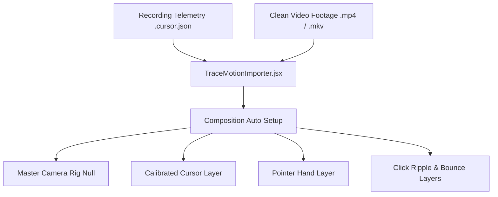

# 🎬 TraceMotion After Effects Importer & Rig Generator

> **ScriptUI Post-Production Suite for Adobe After Effects (CC 2020 through CC 2026+).**

---

## 🌟 Overview

`TraceMotionImporter.jsx` is an ExtendScript tool that parses `.cursor.json` telemetry emitted by the TraceMotion OBS plugin. It automatically imports your recorded video and constructs a complete, production-ready motion graphics camera and cursor rig.

---

## ✨ Features

1. **Recordly Spring Physics Engine**:
   Implements a discrete **Damped Harmonic Oscillator** numerical solver replicating Recordly's motion:
   $$\text{accel} = \frac{-k \cdot (\text{pos} - \text{target}) - c \cdot \text{vel}}{m}$$
   - **Default Tuning**: Mass $m = 1.4$, Damping $c = 60.0$, Stiffness $k = 0.0$ (pure velocity dampening for fluid, jitter-free cursor tracking).
2. **Anchor Point Hotspot Calibration**:
   Eliminates coordinate drift and visual offset by locking the layer anchor point mathematically to the cursor visual tip:
   $$\text{Anchor Point} = [\text{layerWidth} \cdot \text{hotspotX},\, \text{layerHeight} \cdot \text{hotspotY}]$$
   Using `vid.toComp(value)` ensures zero cursor drift even when the 3D camera zooms and dollies.
3. **Recordly Cursor Asset Pipeline**:
   Includes 106 vector SVGs and 106 pre-rendered 512px Retina transparent PNGs ported 1:1 from Recordly:
   - **macOS Tahoe** (`tahoe`): Recordly default modern macOS pointer.
   - **macOS Classic** (`macos`): Classic Apple cursor profile.
   - **Windows 11 Fluent** (`windows11`): Microsoft Fluent Design pointer.
   - **Figma / Custom** (`custom`): Minimal crosshair and modern UI pointer.
   - **Vector Shape**: Procedural fallback shape layer.
4. **Dynamic Hover State Switching**:
   Synchronizes Arrow and Pointer Hand layers with hold-keyframe opacities, switching smoothly when hovering links, inputs, or buttons.
5. **Cinematic Click VFX**:
   - **350ms Half-Sine Bounce**: Cursor scales from $100\% \to 84\% \to 100\%$ on click.
   - **600ms Accent Ripple**: Expanding circular shockwave in Recordly Blue (`#2563EB`) with cubic ease-out fade.

---

## 🚀 How to Use

1. Open **Adobe After Effects**.
2. Run **File -> Scripts -> Run Script File...** and select `TraceMotionImporter.jsx`.
   *(Or place it inside `Scripts/ScriptUI Panels/` for a dockable workspace panel).*
3. Select your video file (`.mp4` or `.mkv`). The script automatically resolves companion `.cursor.json`.
4. Choose your desired **Cursor Style**, **Asset Format** (PNG or SVG), and **Physics Tuning**.
5. Click **Build TraceMotion Rig**.
