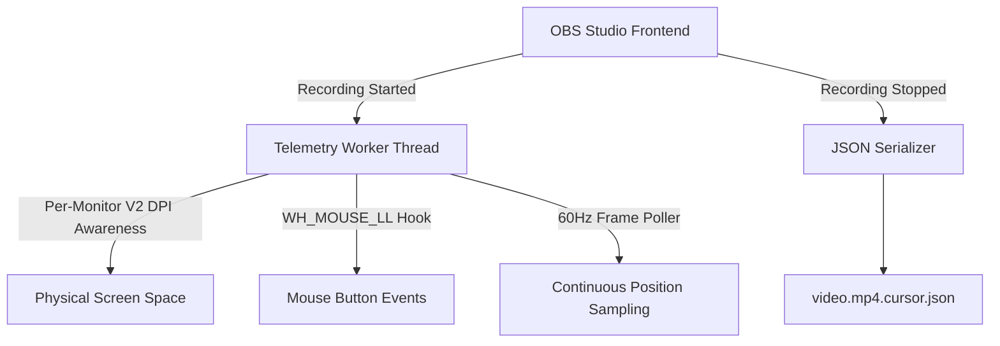

# 📹 TraceMotion OBS Studio Telemetry Recorder

> **High-frequency, Per-Monitor DPI aware mouse telemetry capture plugin for OBS Studio.**

---

## 🌟 Architecture Overview

The `tracemotion-obs` module is a high-performance native C++20 plugin for **OBS Studio** (v30.0+ / v33.0+) that captures physical mouse coordinates, click actions, and cursor visual states synchronously with video frame recording.



### Key Technical Capabilities:
1. **Per-Monitor V2 DPI Awareness**:
   Initializes via `SetThreadDpiAwarenessContext(DPI_AWARENESS_CONTEXT_PER_MONITOR_AWARE_V2)` to ensure hardware cursor coordinates are unscaled physical screen pixels, eliminating high-DPI offset drift.
2. **Zero Dropped Events**:
   Combines asynchronous low-level Win32 hooks (`WH_MOUSE_LL`) with a 60 Hz high-resolution timer (`timeBeginPeriod(1)`) to capture instantaneous button transitions (clicks, double-clicks, releases) and smooth trajectory paths.
3. **Double-Click Classification**:
   Detects consecutive left clicks within 350ms and 0.04 normalized distance, tagging them as `double-click` in the output telemetry.
4. **Display Geometry Tracking**:
   Inspects `obs_video_info` at recording start to embed canvas dimensions (`sourceWidth`, `sourceHeight`, `sourceX`, `sourceY`, `outputWidth`, `outputHeight`) directly into the `.cursor.json` header for exact aspect ratio and coordinate alignment in post-production.

---

## 🚀 Installation

### Automated 1-Click Install (Recommended)
1. Close OBS Studio if it is open.
2. Right-click `install.bat` and select **"Run as administrator"**.
3. The script deploys `tracemotion-obs.dll` and `data/manifest.json` across all modern and legacy OBS plugin search paths:
   - `C:\ProgramData\obs-studio\plugins\tracemotion-obs\` (Modern OBS 33+)
   - `%APPDATA%\obs-studio\plugins\tracemotion-obs\`
   - `C:\Program Files\obs-studio\plugins\tracemotion-obs\`
   - `C:\Program Files\obs-studio\obs-plugins\64bit\`

### Manual Installation
Copy `build/tracemotion-obs.dll` to:
```text
C:\Program Files\obs-studio\obs-plugins\64bit\tracemotion-obs.dll
```
And copy `data/manifest.json` to:
```text
C:\ProgramData\obs-studio\plugins\tracemotion-obs\manifest.json
```

---

## 🛠️ Building from Source

### Prerequisites
- **Visual Studio 2022 / 2026** with the **Desktop development with C++** workload.
- **Windows 10 / 11 SDK** (v10.0.19041+ or v10.0.28000+).
- **CMake 3.20+** (if building with CMake).

### 1-Click Automated Batch Build
Run `build.bat` from an elevated Developer Command Prompt or simply double-click it. It will:
1. Initialize the Visual Studio environment via `vcvarsall.bat x64`.
2. Generate OBS API import definitions (`deps/obs/lib/obs.lib` and `obs-frontend-api.lib`).
3. Compile and link `build/tracemotion-obs.dll` using MSVC C++20 `/O2 /EHsc /utf-8`.

### CMake Build
```powershell
mkdir build
cd build
cmake .. -A x64 -DOBS_DIR="C:/Program Files/obs-studio"
cmake --build . --config Release
```

---

## 📄 Output Data Schema

Telemetry is emitted next to your recording file with the extension `.cursor.json`:
```json
{
  "version": 2,
  "canvas": {
    "sourceWidth": 1920,
    "sourceHeight": 1080,
    "sourceX": 0,
    "sourceY": 0,
    "outputWidth": 1920,
    "outputHeight": 1080
  },
  "samples": [
    {
      "timeMs": 0,
      "cx": 0.5000,
      "cy": 0.5000,
      "interactionType": "move",
      "cursorType": "arrow"
    }
  ]
}
```
